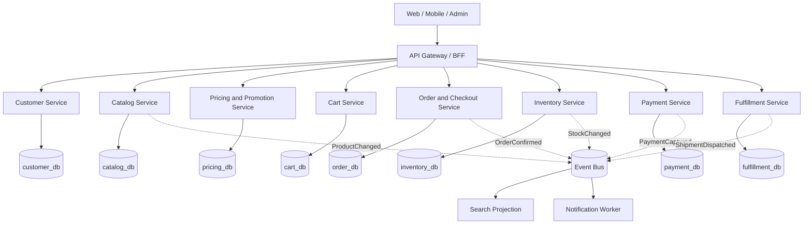
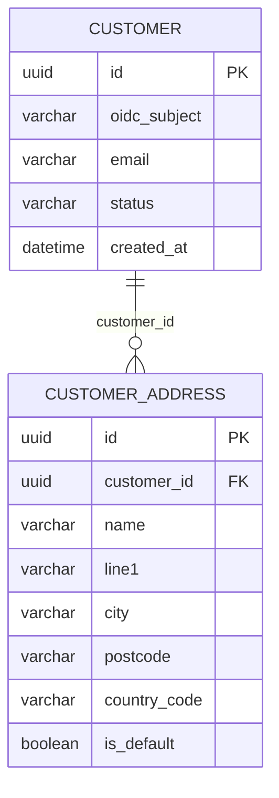
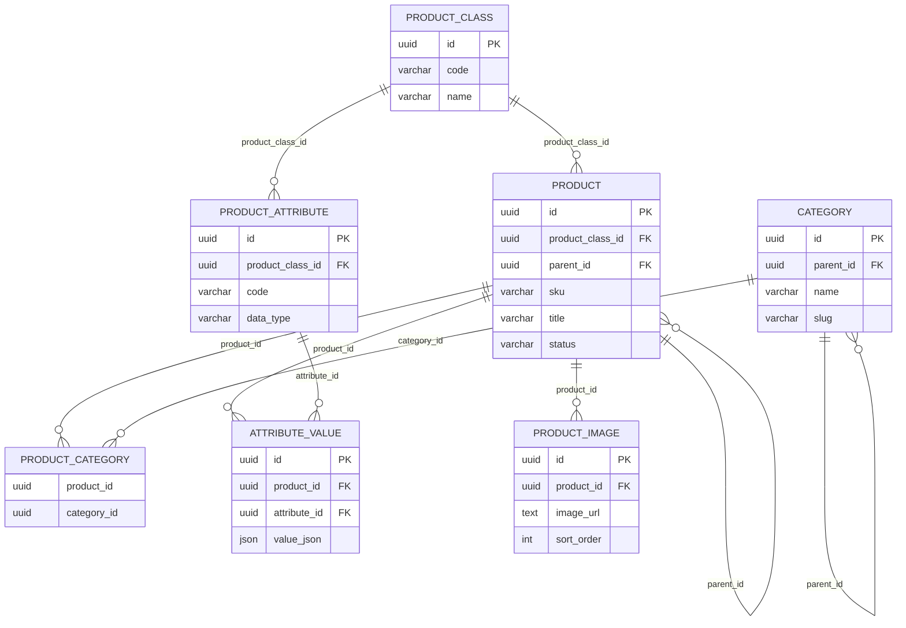
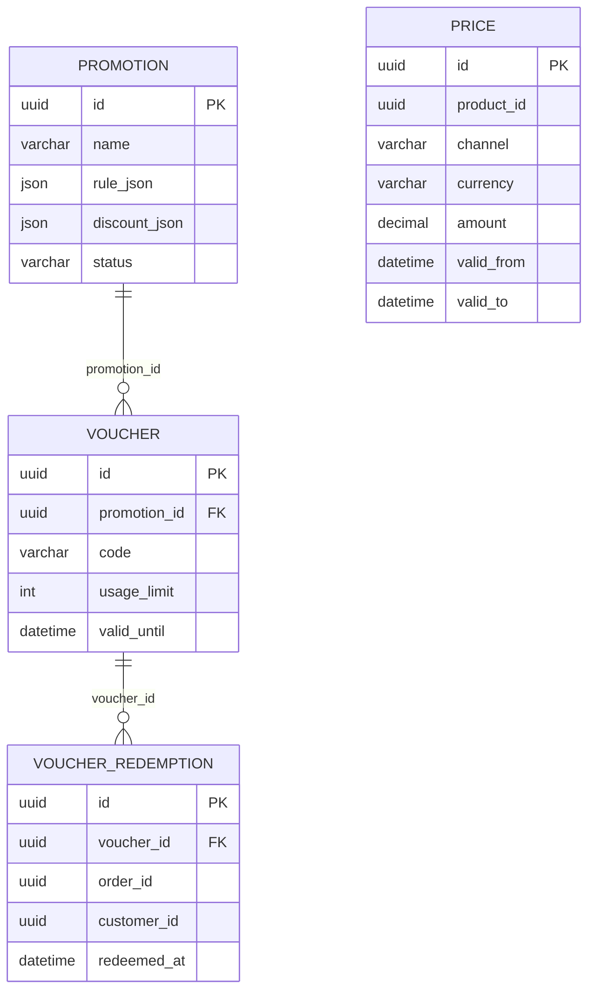
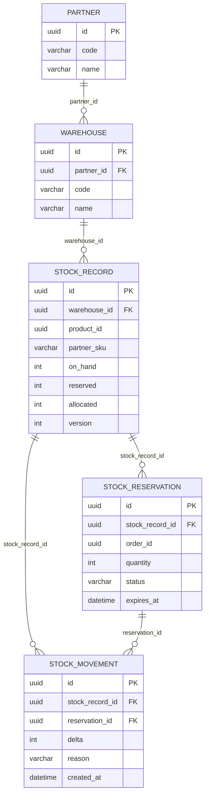
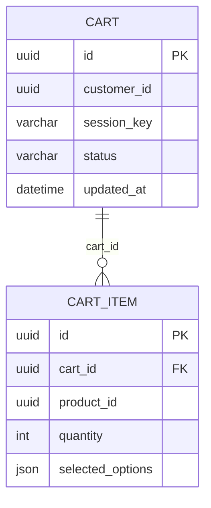
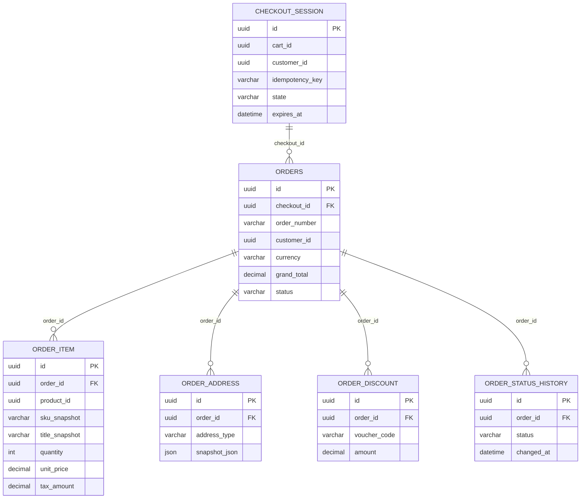
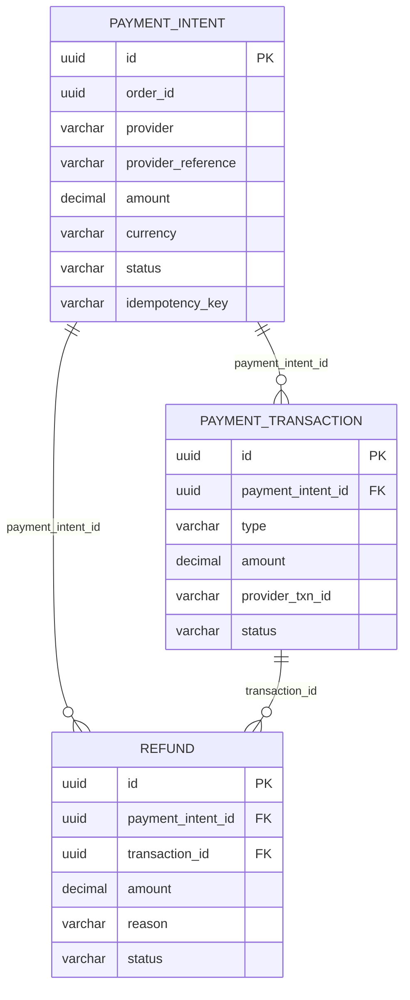
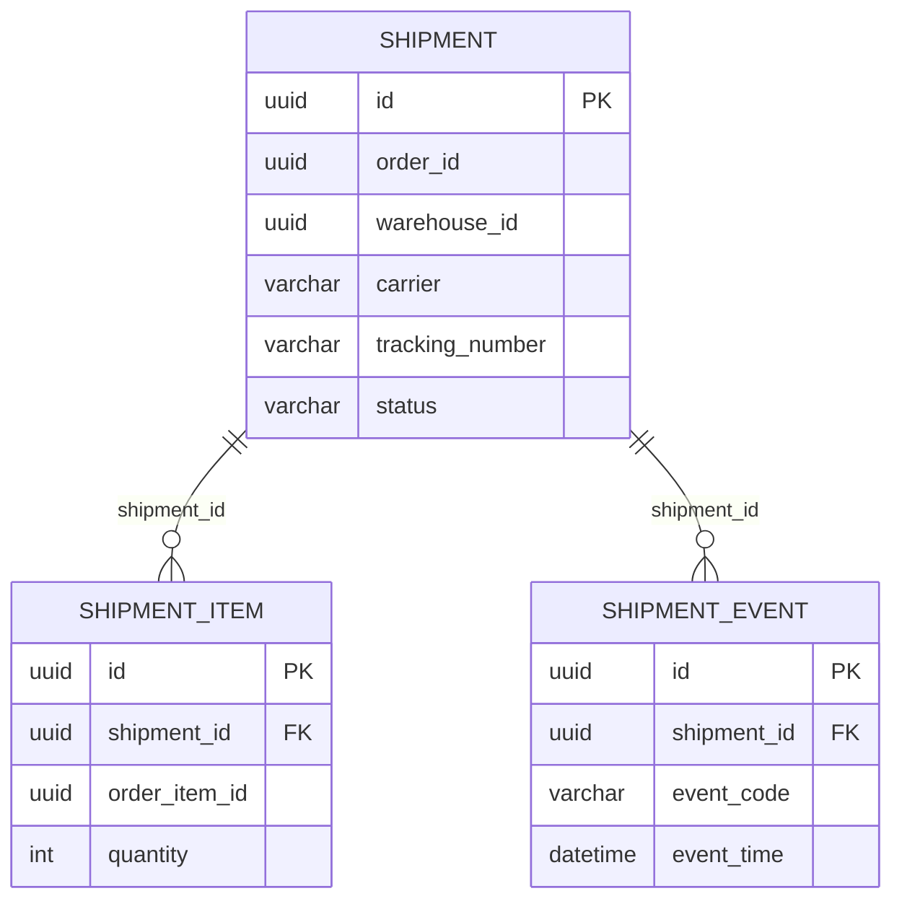

# Nexa Commerce — Microservices (Proposed Target Design)

**Legacy reference (original Django Oscar framework):** https://github.com/django-oscar/django-oscar ; https://django-oscar.readthedocs.io/

> This is an architecture proposal and redesigned logical schema, **not** an exact extraction of Django Oscar model tables.

## 1. Architecture



Each service owns its own PostgreSQL database (separate credentials/migration/backup). Cross-service identifiers are UUID references only, never foreign keys.

## 2. Database ERDs (per bounded context)

### Customer (customer_db)



### Catalog (catalog_db)



### Pricing & Promotion (pricing_db)



### Inventory (inventory_db)



### Cart (cart_db)



### Order & Checkout (order_db)



### Payment (payment_db)



### Fulfillment (fulfillment_db)



## 3. Checkout / Payment Saga (orchestration)

```mermaid
sequenceDiagram
    autonumber
    actor Buyer
    participant API as API Gateway
    participant Order as Order and Checkout
    participant Price as Pricing and Promotion
    participant Stock as Inventory
    participant Pay as Payment
    participant Bus as Event Bus
    Buyer->>API: POST /checkouts (Idempotency-Key)
    API->>Order: Start checkout
    Order->>Price: Validate quote and voucher
    Price-->>Order: Signed quote with expiry
    Order->>Stock: Reserve items (order_id, TTL)
    alt Out of stock
        Stock-->>Order: Rejected
        Order-->>Buyer: 409 Stock unavailable
    else Reserved
        Stock-->>Order: reservation_ids
        Order->>Pay: Authorize(amount, order_id, idem key)
        alt Authorization declined
            Pay-->>Order: Declined
            Order->>Stock: Release reservations
            Order-->>Buyer: Payment declined
        else Authorized
            Pay-->>Order: Authorized
            Order->>Stock: Commit reservation to allocation
            alt Inventory commit fails
                Order->>Pay: Void authorization
                Order->>Stock: Release reservations
                Order-->>Buyer: Checkout failed; retry safely
            else Stock committed
                Order->>Order: Confirm order + immutable snapshots + outbox in one transaction
                Order->>Bus: OrderConfirmed (via outbox)
                Order-->>Buyer: 201 Order confirmed
            end
            Note over Pay,Bus: Capture according to fulfillment policy; refund/void on later failure
        end
    end
```

## 4. Communication & contracts

| Caller | Provider | Protocol | Purpose |
|---|---|---|---|
| Storefront | API Gateway/BFF | REST/HTTPS | UI composition, auth, throttling |
| Order | Pricing | REST/gRPC | Revalidate price/discount, return immutable quote |
| Order | Inventory | REST/gRPC | Atomic stock reservation, commit/release with TTL |
| Order | Payment | REST/gRPC | Create idempotent payment authorization |
| Order | Fulfillment | Events / API | Start picking/shipping after confirmed order |
| Any owner | Search and Notification | Event Bus | Materialized read model and customer messages |

## 5. Event catalog (examples)

`catalog.product.updated.v1`, `pricing.price.changed.v1`, `inventory.stock.changed.v1`, `inventory.reservation.expired.v1`, `order.confirmed.v1`, `order.cancelled.v1`, `payment.authorized.v1`, `payment.captured.v1`, `payment.failed.v1`, `fulfillment.shipment.dispatched.v1`.

Event envelope: `event_id`, `event_type`, `event_version`, `occurred_at`, `aggregate_id`, `correlation_id`, `payload`; avoid publishing sensitive customer address and raw payment data.

## 6. Design constraints

- Each service owns its schema, migrations, and outbox. Consumers deduplicate by `event_id` in inbox tables.
- Inventory reservation is atomic and expires automatically; `available = on_hand - reserved - allocated` and quantity cannot exceed available stock. Commit moves `reserved → allocated`; dispatch decrements both `on_hand` and `allocated`.
- Order stores immutable snapshots (SKU/title/unit price/tax/addresses) rather than relying on mutable Catalog and Customer rows.
- Payment webhooks must verify signatures and deduplicate provider transaction IDs. Never store raw card data.
- Handle compensation: release reservation after payment decline; void payment authorization on inventory/order failure; reverse stock allocation on local order-commit failure; refund per business policy after capture. An order is only externally CONFIRMED after allocation and durable order state succeed.
- Checkout `Idempotency-Key` prevents repeat order/payment on retries.
- Auth can be an OIDC identity provider; Customer service owns profile data and customer addresses.
- Search and Notification are projection/worker services, not authoritative databases.

## 7. Migration mapping: Django Oscar → Nexa Commerce

| Oscar app / model | Target | Important change |
|---|---|---|
| `catalogue.Product`, `Category`, `ProductClass`, attributes | Catalog | Own catalogue product metadata |
| `partner.Partner`, `StockRecord` | Inventory + Pricing | Split stock/partner from selling price, which Oscar typically couples through StockRecord/strategy |
| `basket.Basket`, `Line` | Cart | Basket references catalog product by UUID; price revalidated on checkout |
| `offer.*`, `voucher.*` | Pricing & Promotion | One rules/discount context initially; may split later |
| `order.Order`, `Line`, `OrderDiscount` | Order & Checkout | Immutable snapshot and orchestrated checkout |
| `payment.Source`, `Transaction` | Payment | Use provider reference, payment intent, captured/refund lifecycle |
| `order.ShippingEvent`, `shipping.*` | Fulfillment | Own shipment/shipment items/tracking |
| `address.*`, `customer.*`, `auth user` | Customer + OIDC IdP | Distinguish login identity from customer business profile |

## 8. Incremental migration from Django Oscar (strangler pattern)

1. Establish shared OIDC, gateway, correlation IDs, observability, and schema versioned events; keep Oscar as system of record.
2. Extract Catalog read APIs/search projections, then Cart; serve their APIs without cross-service writes.
3. Isolate Inventory with reservation API; stop order code from writing stock tables directly.
4. Extract Pricing & Promotion quote APIs; compare totals via shadow checks against Oscar.
5. Move Order/Checkout orchestration and Payment using outbox, webhooks and reconciliation, with order ID mapping.
6. Move Fulfillment and Customer data by ownership; retire corresponding Oscar paths only after dual-read validation.

**Warning:** Avoid bidirectional dual-write to Oscar and new services. Pick a single owner per entity and migrate through change-data-capture or outbox to avoid divergent records.
