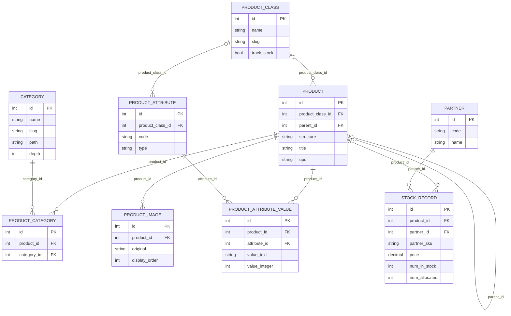
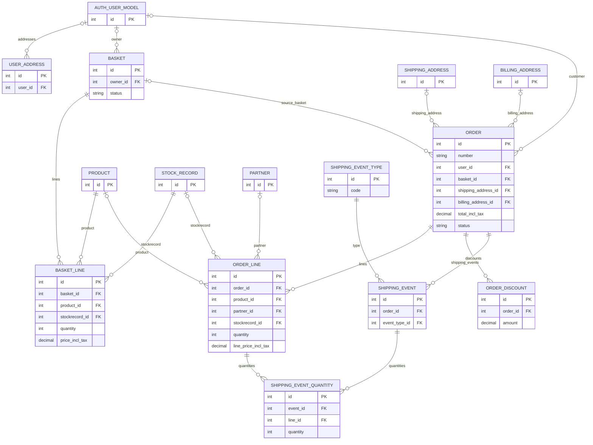
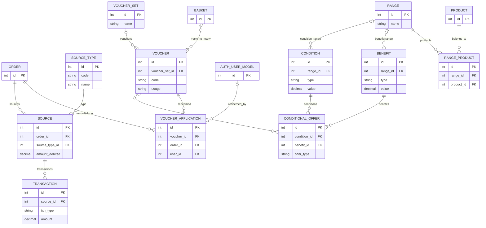

# Django Oscar — Core Database ER Diagrams

Source: https://github.com/django-oscar/django-oscar (master branch; inspected 2026-11-22)

These are **selected core Django Oscar models** and principal relations, not a full dump of all Django/Oscar tables. `AUTH_USER_MODEL` is configurable. `PK` and `FK` are shown explicitly in the image diagrams. Ellipses (`...`) abbreviate omitted columns. Nullable foreign keys are represented with optional cardinality. Django's ManyToMany creates join tables; some are automatic rather than declared as named model classes. The models shown can be customized using Oscar's forkable app/model mechanism.

## 1. ERD — Overview

```mermaid
erDiagram
    AUTH_USER_MODEL o|--o{ BASKET : owner
    AUTH_USER_MODEL o|--o{ ORDER : customer
    PRODUCT_CLASS o|--o{ PRODUCT : class
    PRODUCT o|--o{ PRODUCT : parent
    PRODUCT ||--o{ PRODUCT_CATEGORY : category_memberships
    CATEGORY ||--o{ PRODUCT_CATEGORY : product_memberships
    PRODUCT ||--o{ STOCK_RECORD : stockrecords
    PARTNER ||--o{ STOCK_RECORD : stockrecords
    BASKET ||--o{ BASKET_LINE : lines
    PRODUCT ||--o{ BASKET_LINE : lines
    STOCK_RECORD ||--o{ BASKET_LINE : lines
    BASKET o|--o{ ORDER : checkout_origin
    ORDER ||--o{ ORDER_LINE : lines
    PRODUCT o|--o{ ORDER_LINE : optional_product
    ORDER ||--o{ SOURCE : payment_sources
    SOURCE ||--o{ TRANSACTION : transactions
    ORDER ||--o{ SHIPPING_EVENT : shipping_events
    BASKET }o--o{ VOUCHER : many_to_many
    ORDER ||--o{ VOUCHER_APPLICATION : voucher_use
    VOUCHER ||--o{ VOUCHER_APPLICATION : applications
```

## 2. ERD — Catalogue & Inventory



## 3. ERD — Baskets, Orders, Fulfilment



## 4. ERD — Payments, Vouchers, Offers



### Notes

- `catalogue.Product` includes standalone, parent and child product structures; `Product.parent_id` stores child-to-parent linkage.
- `partner.StockRecord` stores per-partner SKU, inventory and price details; the price is not a primary attribute of `catalogue.Product`.
- `basket.Line` and `order.Line` are two distinct models/tables. Checkout copies order line information; the default model has no `basket_line_id` FK on `order.Line`.
- `order.Order` can be placed by a guest (`user_id` nullable) and can retain a link to the original basket (`basket_id` nullable).
- `order.OrderDiscount.offer_id` and `voucher_id` are ordinary integer snapshot fields, **not** Django `ForeignKey` relations.
- `basket.Basket.vouchers` and `voucher.Voucher.offers` are M2M fields creating implicit join tables.

References: [catalogue](https://github.com/django-oscar/django-oscar/blob/master/src/oscar/apps/catalogue/abstract_models.py) · [partner](https://github.com/django-oscar/django-oscar/blob/master/src/oscar/apps/partner/abstract_models.py) · [basket](https://github.com/django-oscar/django-oscar/blob/master/src/oscar/apps/basket/abstract_models.py) · [order](https://github.com/django-oscar/django-oscar/blob/master/src/oscar/apps/order/abstract_models.py) · [payment](https://github.com/django-oscar/django-oscar/blob/master/src/oscar/apps/payment/abstract_models.py) · [voucher](https://github.com/django-oscar/django-oscar/blob/master/src/oscar/apps/voucher/abstract_models.py) · [offer](https://github.com/django-oscar/django-oscar/blob/master/src/oscar/apps/offer/abstract_models.py).
